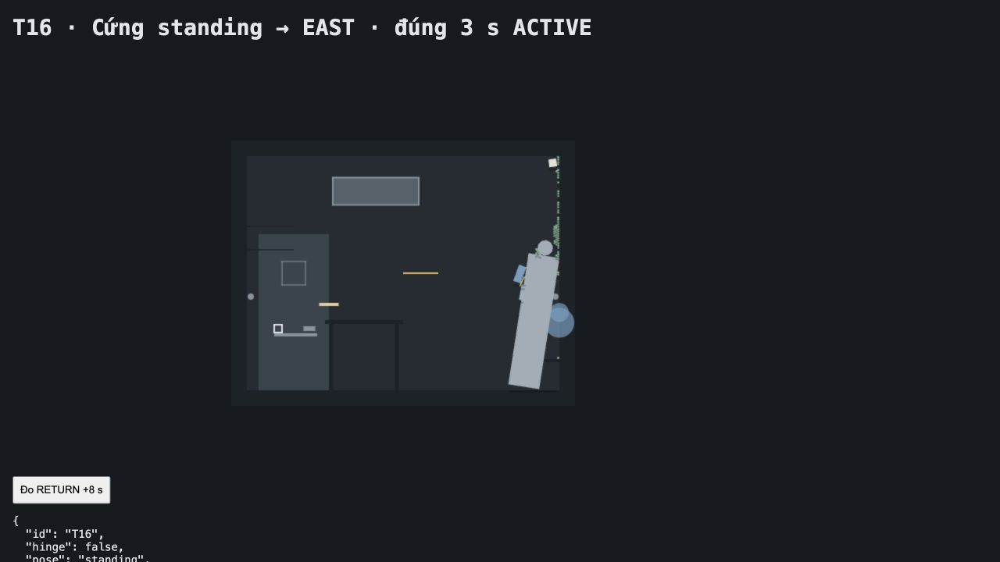

# Báo cáo T16–T21 và hồi quy T1–T15 + T1b — 11/10/2026 · sandbox v0.3

Đã đọc `docs/spec-sandbox-v0.3.md`, thay v0.2. Mặc định **mannequin.hinge=false**: hình nộm trở lại compound cứng **thân 0,4×1,7 m + đầu r=0,10 m** như proto v0.4; code hai khúc/khớp giữ sau cờ hinge. Sandbox đọc **mannequin.pose=standing**, tâm **(2,5;0,85)**. Proto/T21 vẫn **cứng, lying**, tâm **(1,9;0,2)**, đầu hướng Đông. R4 chỉ xét **trục thân**, không xét chân. T16 dùng tiêu chí standing mới; T21 dùng tiêu chí spec-proto v0.4, khôi phục T2 đồ bàn ≤0,5 m. Giữ **gelCoatMin=1 / coatRadius=0,25 m**.

Không sửa spec hoặc `proto/index.html`. Giữ **g=9,81 m/s²**, hình nộm **70 kg**, mọi khối lượng/ma sát, detent mặc định **6 N** và các vị trí đã quy định. `rules/` chỉ import `params.js`, không Phaser/Matter/game/view/world. Nhật ký không ghi hướng, schema `{t,event,origin[,user]}`. Tư thế proto dùng tên `mannequinPose` cũ để giữ debug và T1b; sandbox khởi tạo từ `mannequin.pose`.

**Kết quả: T16–T21 đều PASS. T21: 15/15 PASS; T1b ghi nhận riêng. R4 standing theo trục thân PASS. T14: baseline 120,000 Hz, engine 118,427 FPS.** Không cần đối chứng tham số mới hoặc đề xuất thêm.

Môi trường: MacBook/macOS, in-app browser Chrome 155, Phaser 3.90.0/Matter đi kèm; canvas 960×540, fixed-step 1/120 s. Server `127.0.0.1:4174` gửi `Cache-Control: no-store`. Test chức năng chạy engine thật bằng bước mô phỏng. T16/T17–T20 chạy SandboxScene, có bình và kệ dụng cụ; T21 chạy ProtoScene không thêm vật sandbox. T14 lấy 30 s thực ở ×60, 60 gel, sau trang trắng đo rAF 10 s trong cùng tab, visible/focus=true và không bị ẩn trong baseline.

| Test | Kết quả | Số đo thực tế và nhận xét |
|---|---|---|
| T16 | **PASS** | Cứng standing, tâm ban đầu **(2,500000;0,850000)**, **1 body/70 kg**, EAST 60 s. Sau **3,000 s ACTIVE**: góc thân **8,784571°**<30; mép cách Đông **0,001844 m**≤0,1; **0** va bàn. RETURN+8 s: **4/60 gel** ngoài dải 1,0 m, đạt ≤6; xa nhất **1,987152 m**. Không dùng tư thế hình nộm sau RETURN để chấm điểm. |
| T17 | **PASS** | Tối đa **3** mục, chạy đúng **22:00 / 22:03 / 22:06** dù nhập không theo thứ tự. Mục thứ 4, mục chồng còi và `[null]` bị từ chối, danh sách cũ còn nguyên. **3 SCHEDULE_EDIT** cho 3 lần sửa, mỗi sửa 1 dòng. UI: lịch EAST 21:59/60 s → mốc hẹn tiếp **22:01:10**; thêm WEST 22:02/60 s → **22:04:10**; xóa mục sau → **22:01:10**. |
| T18 | **PASS** | Trước cứu: chốt **0,200 m**, enter=false, đúng thông báo “Chốt bên trong đã cài. Không mở được từ hành lang.” Intercom=true. Đợi cooldown **57,000 s** rồi WARN; `MANUAL_START t=79040,008333, origin=master, user=LAM`; RETURN **79100,008333**. Sau +3 s chốt **0**, enter=true. **4** dòng nhật ký không hướng. |
| T19 | **PASS** | Thuần: R1–R5 mỗi quy tắc **1** sự kiện, **10** đối chứng âm không kích hoạt (gồm chân dọc nhưng thân ngang). Chọn sai 1 lần rồi đúng, mỗi quy tắc chỉ **1** unlock record. Engine: R2 **78913,008333**, R3 **78917,008333**, R1 **78978,008333**, R5 **78983,008333**, mỗi quy tắc 1 lần; bút cũ phủ, bút mới `coatedAt=null`. R4 theo trục thân ở dòng dưới. |
| T20 | **PASS** | Quỹ đạo ca khi cố kéo so với không kéo: **Δ=0,000000 m** trong cả WARN và ACTIVE. Mouse constraint stiffness=0, bodyB=null; IDLE cho tương tác. |
| T21 | **PASS** | Chạy đủ **T1–T15 + T1b** với proto cứng lying, headRadius=0,10, vị trí và tiêu chí v0.4; chỉ luật coat là **1/0,25**. **15/15 PASS**; T1b OBSERVATION. Không dùng sandbox standing để làm hồi quy PASS. |
| R4 theo trục thân | **PASS** | Cứng standing, quan sát qua kính **2,036400 s thực**; R4 kích hoạt đúng **1** lần tại **78918,008333**. Góc thân **8,784571°**, mép cách Đông **0,001844 m**. Đối chứng thuần: chân dọc, thân ngang, nhìn từ 0 tới 4 s → **0 R4**. |

## T16 — ACTIVE và đối chiếu

Hình nộm dựng dọc Đông, đầu phía trên, tương ứng hình ảnh [standing v0.4](tests/playtest-v0.4/standing-active.jpg). T16 được đo trên sandbox thật, gồm bình/kệ mới; không dùng kết quả standing proto lịch sử thay cho lượt chạy này. [RETURN+8 s](tests/sandbox-v0.3/t16-return.jpg) có 4 gel ngoài dải, đạt tiêu chí v0.3. [Ảnh R4 qua kính](tests/sandbox-v0.3/r4-standing-window.jpg) được lưu cùng số đo.

## T21 — từng test hồi quy

Cấu hình: compound cứng lying, 70 kg, thân 0,4×1,7, đầu r=0,10, tâm (1,9;0,2), g/ma sát/detent/vị trí v0.4. T4 dùng detent=12 N và T7 dùng dryTime=30 s theo chính fixture rồi reset; T15 tạm bỏ trần/vật khác để đo rơi 3 m rồi reset. Không nới ngưỡng T1/T2/T11; T2 đồ bàn trở về ≤0,5 m, hình nộm mép ≤0,1 m; T12 min=1/r=0,25 theo spec sandbox v0.3.

| Test | Kết quả | Số đo thực tế và nhận xét |
|---|---|---|
| T1 | **PASS** | Ban đầu đúng **(1,900000;0,200000)**, 1 body/70 kg, đầu Đông; bounds x=[**1,010642;2,910642**], y=[0;0,4], khớp cấu trúc v0.4. Ca/bút/sổ tới Đông **0,883333 / 1,016667 / 1,033333 s**, đều <1,5. Hình nộm **0,533333 s**, tâm y=**0,202777 m**<0,6 ở mẫu 2,283333 s; **0** va bàn; **60/60 gel** tới Đông. Chốt đóng **0,283333 s**, lực **11,772 N**. |
| T1b | **GHI NHẬN** | Standing ban đầu **(2,5;0,85)**. Hình nộm tới Đông **0,516667 s**; chạm ca/bút/sổ lần đầu **0,808333 / 0,925000 / 0,941667 s**. Ca tới tường **1,358333 s**; bút/sổ chưa ghi được chạm trực tiếp tường trong 3 s. **0** va bàn, **60/60 gel** tới Đông. Bài quan sát không chấm pass/fail. |
| T2 | **PASS** | RETURN+8 s: ca/bút/sổ cách Đông **0,160422 / 0,032499 / 0,299716 m**, đều ≤0,5. **0/60 gel** ngoài dải 1 m; xa nhất **0,945348 m**. Mép hình nộm x=**4,000205 m**, lệch **0,000205 m**≤0,1; tâm y=**0,188735 m**. Tốc độ lớn nhất **0 m/s**, chốt còn **0,200 m**. |
| T3 | **PASS** | Chốt mở **0,283333 s**; **60/60 gel** trong khay. x ca/bút/sổ sau 5 s **0,049986 / 0,007225 / 0,023588 m**. |
| T4 | **PASS** | Lực ngang **11,772 N**<detent đối chứng **12 N**: dịch **0 m** sau 5 s. Detent mặc định vẫn 6 N. |
| T5 | **PASS** | Pool Đông y=**0,997246 m**, đạt 0,9±0,2; streak xuống y=**0**. Ca trượt TABLE theo Đông có vận tốc pháp tuyến **0 m/s**, không đổ do trượt. RETURN **t=79810**, **110.161** substeps. |
| T6 | **PASS** | Streak từ (1,5;0), dài **0,939167 m**; wetness **0,939160**. Pool còn, r=**0,085381 m**, sau co 50%. |
| T7 | **PASS** | dryTime=30 s, chờ 60 s: wetness **0**, **0 STREAK**. |
| T8 | **PASS** | **SPLASH→STREAK**, **0 POOL**; vệt khi DOWN kết thúc **(4;0)**. |
| T9 | **PASS** | Trong WARN và ngay RETURN enter=false; trước +3 s vẫn khóa. Vào được ở mẫu **3,016667 s**. Bài proto kiểm khóa hệ thống; T18 sandbox kiểm thêm chốt. |
| T10 | **PASS** | Cửa mở: start=false, IDLE, thông báo “Từ chối: cửa đang mở”. |
| T11 | **PASS** | Ô kính **270×270 px**, zoom **0,675×**, chốt đi **13,5 px**. Mép hình nộm x=**4,001082 m**, lệch **0,001082 m**≤0,1; **0** vật ở sàn cũ. SCHEDULED_START **22:00:00**, RETURN **22:15:00**, unlock **22:15:03**; khóa trước/sau đúng, schema chỉ t/event/origin. |
| T12 | **PASS** | **60/60 gel** dừng đủ 2 s sau **4,766667 s ACTIVE**. Bút cũ có **5** gel hợp lệ trong r=0,25, `coatedAt=78916,908333`; gel hợp lệ gần nhất cách **0,042009 m** trước thả. Bút mới gần **37** gel nhưng **0** hợp lệ theo thời gian, `coatedAt=null`. Không đổi bán kính sang đối chứng 0,5 của vòng trước. |
| T13 | **PASS** | Lớp **WIPE→POOL→STREAK**; nước sau nằm trên dấu lau. |
| T14 | **PASS** | Baseline **1.200 frame / 10,000 s = 120,000 Hz** trước engine. Engine **3.553 frame / 30,0016 s = 118,427017 FPS**, đạt ≥55. Median **8,3 ms**, p95 **10,5 ms**, max **337,3 ms**. **215.997 substeps**, mô phỏng **1799,975 s**, tốc độ **59,995967×**; 60 gel, ×60, trang visible. Không cắt timestep để lấy FPS. |
| T15 | **PASS** | Ca rơi **3 m** trong **0,783333 s**, lý thuyết **0,782062 s**, đạt 0,75–0,82. gravity.scale=**0,000981**, dt=**0,008333 s**. |

## Cờ hinge, dụng cụ và ranh giới

| Kiểm | Kết quả | Bằng chứng |
|---|---|---|
| Cứng / khớp, hai tư thế | **PASS** | `hinge=false` lying/standing: **1 body, 70 kg, không hip constraint**, tâm đúng (1,9;0,2)/(2,5;0,85), neo/tháo không còn constraint. `hinge=true` lying/standing: **2 body, tổng 70 kg, có hip constraint**; tham số khúc 45/25 và damping=0 giữ nguyên. Cả 4 trường hợp bỏ TABLE ở mọi part và bước engine không lỗi. Cờ true chỉ dùng kiểm tra code còn hoạt động, không dùng chấm T16/T21. |
| R4 theo thân | **PASS** | Snapshot body cứng mang `segment=torso`; chân không đủ để kích hoạt R4. Đối chứng nhìn 4 s với chân dọc/thân ngang không phát hiện; thân dọc đủ 2 s phát hiện một lần. |
| Bình / kệ / refill | **PASS** | Dưới ngưỡng nghiêng còn **0,5 L**, trên ngưỡng còn **0**, body vẫn tồn tại. Đổ kệ nhận **SHELF**, **0,5→0,4 L**; refill **0,5 L**, refill trong WARN=false. |
| Luật / tham số / cú pháp | **PASS** | Node guards kiểm g, khối lượng, ma sát, detent, hình học, cả tọa độ standing/lying, coat 1/0,25, journal và import thuần. **23 module** src/harness hợp lệ cú pháp. Sandbox, sandbox harness và regression: warn/error **0 mục**. |

## Chưa làm / lệch spec

- **Không còn test tự động fail hoặc sai lệch changelog v0.3 đã phát hiện.** Đủ T16–T21 và T1b; không đề xuất thay tham số sau khi hồi quy 15/15 đạt.
- **Chưa playtest 2 người thật**, mỗi người 10–15 phút; chưa xác nhận họ tự phát biểu R1/R3 và phản ứng “người trên tường”. Giữ `docs/playtest-log.md` nguyên trạng, không ghi người chơi hoặc lời nói giả.
- Chưa chạy lại toàn bộ lượt thao tác UI mở đủ 5 quy tắc như v0.1; vòng này chạy engine R1–R5, quiz/negative controls thuần, lịch UI, intercom và khóa chuột. Cờ hinge=true chỉ kiểm cấu trúc/hình học/neo/bước engine, không hiệu chuẩn lại ragdoll vì v0.3 không dùng nó.
- Nhánh T14 “môi trường (throttle)” giữ từ v0.2, nhưng baseline lượt mới 120 Hz nên không tái tạo môi trường <55 Hz. Nếu gặp baseline <55, runner ghi nhãn này và yêu cầu đo lại với cửa sổ focus, màn hình chính, không tiết kiệm pin. Chưa thử Safari/cảm ứng; không đổi cấu hình màn hình/nguồn điện của người dùng.
- Không thêm Lab A, phòng điều khiển, nhân vật di chuyển, art, âm thanh hoặc lưu game ngoài phạm vi.

## Tái chạy và dữ liệu

`node proto/tests/rules.test.mjs`. Server từ gốc: `python3 -m http.server 4173 --bind 127.0.0.1 --directory proto`; `sandbox.html` để chơi. Khi sửa code cần no-store/hard reload; phiên kiểm thử này dùng cổng 4174.

Runner: `tests/t16.html` đo sandbox standing ACTIVE rồi nút RETURN; `tests/sandbox-tests.html` cho T17 UI/T18/T19/T20, R4 và cờ hinge. **`tests/raf-baseline.html` trước T14**, chờ 10 s rồi theo liên kết cùng tab đến `tests/regression.html`, chờ hồi quy và bấm Đo T14 để lấy 30 s thực. Không lấy FPS từ thời gian chạy test đồng bộ.

Dữ liệu mới trong `tests/sandbox-v0.3/`: `results-t16.json`, `results-pure.json`, `results-engine.json`, `results-baseline.json`, `results-regression-functional.json`, `results-regression.json`; ảnh `t16-active.jpg`, `t16-return.jpg`, `r4-standing-window.jpg`, `sandbox-standing.jpg`. Báo cáo v0.2 trước khi ghi đè giữ tại `tests/sandbox-v0.3/TEST-REPORT-v0.2.md`; dữ liệu v0.1/v0.2 giữ riêng, không dùng thay kết quả mới.

SHA-256 `proto/index.html` không đổi: `4175dace903a5c6e052eab468a68c4a7f034ed907b6c962e39934270544d7a5c`.
